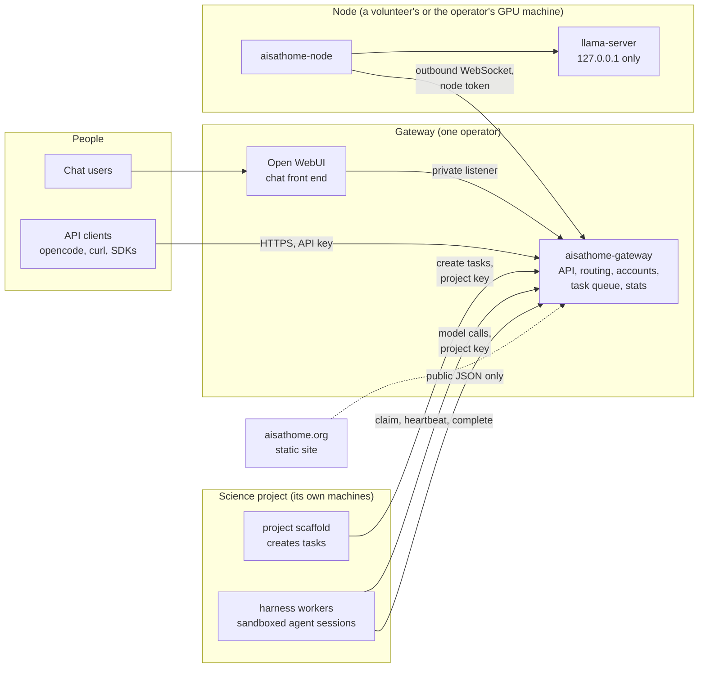

# Architecture

How the pieces of AIs@home fit together, for developers and node operators who want to know
what runs where and who can see what. Details live next to the code: the protocol in
[`protocol/PROTOCOL.md`](../protocol/PROTOCOL.md), the gateway's configuration and behaviour in
[gateway.md](gateway.md), credit in [credit.md](credit.md), the harness in
[`harness/README.md`](../harness/README.md), and the node from the volunteer's side on
[aisathome.org/node](https://aisathome.org/node/).

## The pieces

| Piece | Path | What it is |
|---|---|---|
| Gateway | `gateway/` | `aisathome-gateway`, one Go binary. The OpenAI-compatible API (`/v1/chat/completions`, `/v1/models`), routing with queueing, priorities, preemption and failover, accounts and sign-in, API keys and node tokens, the guards on volunteers' answers, metering and credit, the science task queue, projects' campaigns and external results (in an embedded SQLite database), and the public statistics. Deployed continuously from `main`. |
| Node | `node/` | `aisathome-node`, a small Go agent next to a local `llama-server`. It dials **out** to the gateway (no open ports, works behind NAT), passes requests to the engine and streams the answer back. It has a local status page on `127.0.0.1:7381` and `aisathome-node status`. Released as `v*` tags. |
| Protocol | `protocol/` | The gateway-node WebSocket protocol and its Go types. Versioned with a small integer; a gateway accepts the current and the previous version, so nodes of the last two releases keep working. |
| Harness | `harness/` | `aisathome_harness`, a Python package (standard library only) that runs an open model behind any OpenAI-compatible endpoint as an agent on a science project's tasks, checks the result mechanically and keeps the evidence. It includes the client for the gateway's task queue. Released as `harness-v*` tags. |
| Site | `site/` | aisathome.org: the landing page, docs, dev log, network and science pages (Astro + Starlight), built to static files. A few pages read the gateway's public JSON in the browser and hide themselves when it is not there. |
| Tests | `e2e/` | End-to-end tests in Go: the gateway and node packages against a mock `llama-server` (user → gateway → node → engine), plus the latest two node releases built and run against the current gateway. |
| Other | `tools/sitestats/`, `scripts/`, `examples/` | The site's cookie-free visitor counts, release and bundle builds, example configs. |

### The node on Linux and on Windows

The agent is the same code on both; packaging differs.

- **Linux** (`node/packaging/linux/`): `install.sh` checks the card, driver and speed, then sets
  up two systemd services, `aisathome-llama` and `aisathome-node`, both running as the
  unprivileged user `aisathome` with systemd sandboxing (no access to `/home`, read-only
  system, no new privileges), no core dumps and no swap. A prebuilt bundle carries
  `llama-server` built with CUDA.
- **Windows** (`node/packaging/windows/`): one installer (Inno Setup) installs the agent as the
  service `aisathome-node` under its own virtual account, plus a tray icon
  (`node/cmd/aisathome-tray`). The agent supervises `llama-server` (the pinned upstream
  llama.cpp build) as a child process in a Job object, so the engine never outlives the agent.
  The setup steps (card, model download, speed test, token) run on the node's local page
  (`node/setup`, `node/setupflow`).
- Both get their node token by **linking to an account** (`node/accountlink`, `gateway/nodelink.go`):
  the node asks the gateway for a code, the person approves it on `<domain>/link` signed in, and the
  node's poll gets the token once (a pasted token from the account page still works).

Every node runs one request at a time. The model and context are fixed per tier, not tuned per
machine: 24 GB cards and up run the 4-bit file with 192k context, 16 GB cards the 3-bit file
with 80k. The installer measures the card and refuses one that does not fit a tier. The pins
(model file, SHA-256, llama.cpp release) live in the installer and `node/setup`.

### Anyone can run a gateway

The software is meant to be federated in BOINC's way: many independent gateways, each with its
own domain, users, keys, nodes and limits, sharing nothing by default. A node's config names the
gateway it serves (`gateway_url`), and its operator chooses which. aisathome.org runs one
gateway; [gateway.md](gateway.md) is how to run another.

## A chat or API request

1. **In.** A chat user goes through Open WebUI, which speaks to the gateway on a private
   listener with a front-end key that carries the signed-in user. An API client calls
   `https://<gateway>/v1/chat/completions` with its own key. Each request gets a **class**:
   `chat`, `agent` (people's own API keys) or `science` (a project's key).
2. **Limits.** The gateway checks the key or account: daily weighted-token budget, requests
   per minute, requests in flight.
3. **Privacy filters.** It keeps only the fields a node needs (messages, tools, sampling
   settings) and drops identity fields (`user`, metadata, session ids). Secrets in well-known
   formats (API keys, private keys) are replaced with per-request placeholders. A request that
   looks like personal data (email addresses, card numbers, IBANs, Norwegian ID numbers) may go
   only to the requester's own nodes, and is refused when none of them is online.
4. **Placement.** The gateway picks a node that serves the requested model or role (`deep`,
   `agent`), has a free slot, and whose context fits the request by the gateway's own token
   count. It also applies the privacy rules (below), a cap on how much of the traffic one
   volunteer sees, and the requester's choice of own nodes. A free node that recently served
   the same conversation comes first (its engine has the prefix cached), and a conversation
   stays on the model file it started on. When nodes are busy, waiting requests are served
   chat first, then agent, then science; a person's request that waits too long preempts a
   running science request.
5. **On the node.** The gateway sends a `request` frame over the node's WebSocket. The agent
   posts it to `llama-server` on `127.0.0.1` and streams the chunks back as `chunk` frames,
   then `done` with token counts.
6. **Out.** The gateway restores secrets into the answer if the key asks for it, runs the
   guards on answers from volunteers' nodes (tool calls that download and run code, read
   credential files, upload files, or name web addresses the request never mentioned), and
   streams the answer to the client in OpenAI's format. A node that fails before sending output
   is retried once on another node. From an account's node a flagged answer is only logged, with
   its evidence (unless no person approves the requester's tool calls: a project's or an
   unattended key): the guard cannot tell an honest model reading a credential file from an attack, and
   the client's own command approval is the defence. From a node without an account, a config
   token's node or a pilot, a flagged answer is never released nor sent to another node, and the
   node is held until an operator looks at it.
7. **Accounting.** One usage record per request: time, a pseudonymous user id, class, node,
   tokens, duration, credit, and the guard's rule if one fired. Never the content.

## A science task

Science projects use the network to run an open model as an agent on work whose results a
machine can check (for example Lean proofs). Three parts take part; each owns a different
thing.

| Part | Owns | Does not own |
|---|---|---|
| The project's own code (its *scaffold*) | What the tasks are, their specs and prompts, how results are checked and judged, what comes after a result (the next task, a retry, a submission) | Leases, storage of task state, routing model calls |
| The gateway | The queue and each task's state, leases, the typed public fields, routing the model calls, public views and live counts | Any project's workflow: it acts on no result, schedules nothing by relations, and has no project names in its code |
| The harness | Running one task end to end (session, checks, fix rounds, evidence, checkpoints), the worker lifecycle around the queue, the sandbox | The project's prompts and checks, which the project supplies through `harness/aisathome_harness/project.py` (template in `harness/template/`) |

A project exists in the gateway only as configuration: an id, the SHA-256 of its keys, a daily
token budget, a cap on its share of the nodes, the task **kinds** it may create, and whether
its queue is public (see "Workload classes and science projects" in [gateway.md](gateway.md)).

The flow:

1. **Create.** The project's scaffold creates tasks with its key:
   `POST /v1/projects/{id}/tasks` (idempotent by the client's task id). A task carries a
   `kind` (the claim key, one per scaffold generation, such as `p2m-v7`), an opaque `spec` the
   worker reads (private), an optional `order`, and typed public fields written at creation:
   `role`, the relations `parent`, `needs`, `retry_of` and `replaces`, a `labels` map, and
   `hole_id`. Relations are information only; the scaffold creates a task when it is ready.
2. **Claim with a lease.** A worker calls `POST .../tasks/claim` with the kinds it runs and
   gets the next queued task and a lease (10 minutes by default). Tasks that came back from a
   lease go first, then lower `order`, then oldest. A task that came back is held for its last
   worker for a while, because that worker has its checkpoint.
3. **Run.** The worker (the harness) runs the task: an agent session in a sandbox whose only
   way out is a forwarder that passes only model calls (chat completions and the model list) to
   the gateway, so the key it adds opens nothing else. Its model calls are ordinary chat requests
   with the project's key, class `science`: lowest priority, preemptable, within the
   project's node share and budget. A call may name its task in an `X-Aisathome-Task` header.
4. **Heartbeat.** The worker renews the lease while the task runs. A lease that runs out puts
   the task back in the queue; after `max_tries` tries the task fails. A worker that is
   stopped (a spot interruption, SIGTERM) gives the task back without losing a try. So a dead
   worker never holds a task, and two workers never hold the same one.
5. **Report.** The worker reports `complete` with a small result (an outcome word, a score
   summary, steps, tokens, minutes) or `fail`. That is the end of the gateway's part: "done"
   means the run reported, not that the result is good. Raw evidence stays with the worker.
6. **Publish.** For a project with a public queue, `GET /v1/tasks` (no key) lists its tasks in
   one schema: kind, role, state, outcome, try, relations, labels, counts and times, and the
   classes (volunteer or pilot) of the nodes that served them. While a task runs, a `live`
   object counts the model calls the gateway relayed for it (requests, tokens, model seconds);
   the worker's own numbers replace it at the end. The site's science pages read these views.

Task state lives in the gateway's state directory, one file per task, written atomically, so
the queue survives restarts; a failed disk write answers 503 and changes nothing.

**Workers do not run on volunteer nodes.** The agent's session executes commands the model
writes, so it runs on machines the project's operator controls, inside the harness sandbox
(no network except the forwarder, the API key never inside the container, all capabilities
dropped). Nodes only serve model calls.

## Trust boundaries and privacy

**Hardened, not confidential.** Whoever runs a node can read the prompts and answers it
serves. Consumer GPUs have no way to hide what they compute, so no part of this system claims
confidentiality or zero data retention for prompts on nodes. The measures below make keeping
or misusing data harder, less valuable and more visible.

| Boundary | Who | Can see | Measures |
|---|---|---|---|
| Client → gateway | The gateway's operator | Requests and answers while they pass through | TLS; the gateway does not store prompts or answers (except the evidence of a guard stop or flag below); the usage log has no content |
| Gateway → node | The node's operator | The request body the node serves: messages, tools, sampling settings | No identity (no user, account, key or email reaches a node); well-known secret formats replaced by placeholders; requests that look like personal data only to the requester's own nodes, otherwise refused; agent requests (with tools) to volunteers only with the key's consent and past the node's probation; no volunteer gets more than about a third of recent conversations while others are free |
| Node → gateway | The gateway, the requester | The node's answer | Guards on tool calls in volunteers' answers (an account's node is only logged; a node without an account, a config token's node or a pilot that trips one is held) and flags on unknown addresses, each with its evidence for the operator; revoking a token cuts a node off within seconds |
| Node machine | The node's operator | Everything on the machine | Engine bound to `127.0.0.1`; services sandboxed; no core dumps, no swap for the services, no prompt logging, a bounded prompt cache in RAM. These reduce traces; they cannot stop an operator who wants to look. The terms forbid logging or inspecting prompts |
| Public views | Anyone | Aggregates and public task fields | See below |

**Every node is untrusted**, the maintainer's included. The one exception is a
requester's own nodes: they may get what that requester sends, its personal data included (its
own data on its own machine). Anything that must run on hardware the operator controls, such as
recording the model check's reference, runs on machines that never serve users.

**What the gateway stores.** Accounts by the sign-in provider's user id (or an HMAC of an email
address), API keys and node tokens as hashes, usage records without content under a
pseudonym, daily budgets, the credit ledger and daily history. When a guard stops or flags a
node's answer: the evidence for the operator, a fragment of that answer of at most 300
bytes around what matched (never the request), secrets redacted, kept 14 days and shown to admins
only. In memory only: rate-limit
counters by address, and hashes and lengths of answered conversations (to keep a conversation
on one model file), never their text.

**What the gateway publishes, without a key.**

- `/v1/stats`, `/v1/stats/history`: counts of nodes, requests and tokens, per class and per
  project. Never users, keys, nodes or operators.
- Credit (`/v1/stats/credit`, `/stats/`): per volunteer who chose a public username, in BOINC's
  statistics format.
- `/v1/tasks` and `/v1/projects/{id}/queue`: the public fields of tasks of projects that opted
  in. Never the spec, title, prompts, model text, workers, leases, error text, node ids or node
  owners.

No public view carries a prompt or an answer. A change that would add one is out of scope for
this project.

**Science material is different from chat.** A science task's prompts are public project
material, so its model calls may go to volunteer nodes (a project setting). People's chat and
API prompts are personal: the [privacy page](https://aisathome.org/about/privacy/) says what a
user should assume, and the [terms](https://aisathome.org/about/terms/) what a node operator
promises.

## Versions and compatibility

- **Gateway:** continuous, deployed from `main` after CI and a staging run.
- **Node:** tagged releases (`v*`) with prebuilt binaries, the Linux bundle, the Windows
  installer and `SHA256SUMS` ([RELEASING.md](RELEASING.md)). Node updates are the volunteer's
  choice, so the gateway keeps accepting the previous protocol version; `e2e/compat_test.go`
  runs the latest two releases against the current gateway.
- **Harness:** `harness-v*` tags; a project installs a tagged version.

## Not built yet

Sampled verification of node output, honeytokens, reputation, signed node identity and
gateway key pinning, serving several gateways from one node with resource shares, and signed,
reproducible releases. [`protocol/PROTOCOL.md`](../protocol/PROTOCOL.md) keeps the protocol's
list.
